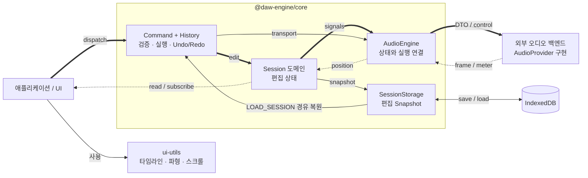

# daw-engine

**멀티트랙 오디오 편집기의 프로젝트 모델과 편집·믹싱·라우팅·재생·익스포트 흐름을 제공하는 TypeScript 라이브러리.**

daw-engine은 트랙, 타임라인 리전, 믹서 경로, 편집 명령을 애플리케이션의 화면과 분리해 다룹니다. 음악 프로젝트의 상태는 엔진이 관리하고, 실제 오디오 재생과 녹음은 애플리케이션이 제공하는 백엔드에 연결합니다. 기존 오디오 기술을 이용해 제품을 만들 때, 개발자가 추가로 구현해야 하는 편집기 공통 구조를 제공합니다.

[도입 이유](#why-daw-engine) · [기존 도구와 비교](#comparison) · [핵심 기능](#features) · [시작하기](#installation) · [Core](./core/README.md) · [UI utilities](./ui-utils/README.md) · [구조](#architecture)

## Why daw-engine?

오디오 편집기를 개발하면 소리를 재생하는 기능 외에도 많은 규칙이 필요합니다. 클립을 어디에 배치할지, 분할한 클립이 어떤 원본을 참조하는지, 편집을 어떻게 되돌릴지, 트랙의 신호를 어느 버스로 보낼지 등을 관리해야 합니다.

실제 편집기를 만들 때 어려운 부분은 **이 기능들을 같은 프로젝트 상태에 맞춰 연결하는 일**입니다.

예를 들어 음성 클립을 둘로 나누고, 뒷부분을 이동한 다음, 리버브 버스로 신호를 보내고 마스터 믹스를 출력한다고 해보겠습니다. 개발자는 클립이 참조하는 원본과 재생 구간을 관리하고, 이동한 위치를 화면과 재생 예약에 반영해야 합니다. 분할과 이동을 취소하면 이전 상태로 돌아가야 하고, 익스포트에서도 현재 프로젝트의 배치와 라우팅을 사용해야 합니다.

daw-engine은 이 과정에 필요한 프로젝트 모델, 편집 명령과 이력, 라우팅 정보, 오디오 백엔드 연결을 재사용할 수 있는 기반을 제공합니다.

## Comparison

차이를 이해하려면 각 도구가 이미 제공하는 기능과, 편집기를 만들기 위해 추가해야 하는 기능을 구분해야 합니다.

### Web Audio API

**Web Audio API는 오디오 처리와 실행을 위한 기반입니다.** 오디오 노드 연결, 믹싱, 효과 처리, 파라미터 자동화, 정확한 시간에 맞춘 재생, 오프라인 렌더링을 제공합니다.

이를 이용해 DAW를 구현할 수 있지만, 트랙과 클립의 편집 모델, 분할·이동 명령, Undo/Redo 같은 프로젝트 규칙은 별도로 만들어야 합니다.

참고: [Web Audio 공식 명세](https://www.w3.org/TR/webaudio-1.0/).

### Tone.js

**Tone.js는 음악적인 재생과 오디오 처리를 쉽게 구성하도록 돕습니다.** Transport 기반 스케줄링, 악기와 이펙트, 자동화, 직렬·병렬 라우팅을 제공하며 오프라인 렌더링도 지원합니다.

따라서 스케줄링이나 믹싱 자체를 daw-engine만의 차별점으로 볼 수는 없습니다. 차이는 클립 편집과 작업 이력, 트랙·버스 관계를 편집기 전체의 모델과 명령으로 관리하는 범위에 있습니다.

참고: [Tone.js 공식 설명](https://tonejs.github.io/), [오프라인 렌더링](https://tonejs.github.io/docs/15.1.22/functions/Offline.html).

### wavesurfer.js

**wavesurfer.js는 파형 표시와 오디오 재생·상호작용에 강점이 있습니다.** 구간 표시, 타임라인, 볼륨 엔벌로프, 녹음 플러그인을 제공하며, 별도의 멀티트랙 확장에는 트랙 위치·볼륨 조절과 동기 재생 기능도 있습니다.

다만 파형 위에 구간을 표시하는 기능에서 출발해 클립 분할·복제, 편집 이력, 센드·버스 라우팅, 믹스 출력까지 구축하려면 프로젝트 로직을 추가해야 합니다. 공식 문서도 wavesurfer.js 자체의 범위를 파형 시각화와 플레이어로 설명합니다.

참고: [wavesurfer.js 공식 문서](https://wavesurfer.xyz/docs/), [멀티트랙 확장 API](https://wavesurfer-multitrack.pages.dev/docs/classes/default).

### daw-engine이 추가하는 역할

daw-engine의 도입 근거는 **제품에 필요한 편집 모델·명령 이력·라우팅·실행 연결을 공통 구조로 재사용할 수 있다는 점**입니다. 기존 오디오 기술과 함께 사용할 수 있도록 `AudioProvider` 경계를 두며, 실제 연결에는 소비 앱의 백엔드 구현이 필요합니다.

프로젝트 상태는 [Session](./core/src/domain/Session.ts), 편집 이력은 [CommandHistory](./core/src/commands/CommandHistory.ts), 상태와 실행의 연결은 [AudioEngine](./core/src/audio/AudioEngine.ts)에서 확인할 수 있습니다.

## Features

- **Source와 Region을 분리한 비파괴 편집 모델**: 원본 소스의 참조와 타임라인 배치를 분리합니다. 일반적인 이동·분할·트림은 원본 오디오를 복제하거나 수정하지 않고, 리전의 소스 참조와 위치·길이 정보로 표현합니다.
- **실행 취소가 가능한 편집 명령**: 주요 편집 동작에 실행·취소·재실행 구조를 제공합니다. 이력 보관 깊이를 설정할 수 있으며, 화면 버튼과 단축키 등 여러 입력에서 같은 명령을 호출할 수 있는 기반입니다.
- **1,920 PPQ 음악적 시간 모델**: 4분음표 한 박을 1,920개의 정수 틱으로 표현합니다. 절대 시간과 박자 기반 시간을 구분하고, 템포에 따른 박자·샘플 프레임 변환을 제공합니다.
- **6종의 트랙 모델**: Audio, MIDI, AUX, BUS, FOLDER, VCA 타입으로 트랙의 역할을 구분합니다. 트랙의 타임라인 배치는 Playlist로, 입출력과 Processor 체인은 Route로 표현합니다.
- **믹싱·라우팅 모델**: 볼륨·팬·뮤트·솔로, 플러그인 파라미터, 센드 레벨과 프리·포스트 페이더 설정을 관리합니다. 사용자가 편집할 트랙·AUX·BUS·마스터의 연결 관계를 프로젝트 정보로 표현합니다.
- **5가지 모드를 갖는 오토메이션 모델**: Read, Write, Touch, Latch, Off 모드 값과 함께 커브 보간, 조작 상태, 기록 구간을 관리하는 API를 제공합니다. 입력 이벤트와 모드별 실행을 연결할 때는 [현재 구현 범위](#automation)를 확인하세요.
- **편집 상태와 오디오 실행의 연결**: 도메인의 변경 알림을 받아 클립 배치와 처리 설정을 백엔드에 전달합니다. `AudioProvider`를 통해 재생, 녹음, 탐색, 루프와 미터링을 연결합니다.
- **익스포트 흐름**: 지정 구간의 마스터 믹스나 선택 트랙을 백엔드에서 렌더링한 뒤 정규화와 파일 인코딩으로 연결합니다.
- **타임라인 화면 도구**: 좌표 변환, 파형, 눈금, 가상 스크롤, Canvas SceneGraph를 제공합니다.
- **TypeScript API**: ESM과 타입 선언 파일을 함께 배포하도록 구성했습니다.

## When to use

음악 제작 도구, 팟캐스트·나레이션 편집기, 교육용 오디오 편집기처럼 **여러 트랙을 배치하고 편집한 결과를 믹스로 출력하는 제품**에 적합합니다.

제품에 맞는 UI와 사용자 경험을 직접 설계하면서, 편집 모델과 명령 이력, 라우팅·재생 연결을 기반부터 모두 구현하는 부담을 줄이고 싶을 때 도입을 검토할 수 있습니다. UI와 오디오 백엔드는 애플리케이션에서 준비해야 합니다.

## Packages

### @daw-engine/core

편집 상태와 오디오 실행을 연결하는 핵심 패키지입니다. 도메인 모델, 명령, 히스토리, 이벤트, 저장, MIDI, 오디오 출력 도구를 포함합니다.

[사용법과 API 보기 →](./core/README.md)

### @daw-engine/ui-utils

`core` 위에서 DAW 화면을 구성하는 도구입니다. 화면 프레임워크에 의존하지 않으며, 애플리케이션의 Canvas나 UI 컴포넌트에서 사용할 수 있습니다.

[사용법과 API 보기 →](./ui-utils/README.md)

## Installation

현재는 저장소에서 두 패키지를 빌드해 로컬 경로로 설치합니다. 개발 도구는 Node.js 18 이상이 필요하며, 아래 예제는 TypeScript와 ESM을 지원하는 번들러 환경을 기준으로 합니다.

### 소스에서 빌드

```bash
git clone https://github.com/HURRAEY/daw-engine.git
cd daw-engine

npm install --prefix core --no-save lamejs
npm run build --prefix core

npm install --prefix ui-utils --no-save ./core
npm run build --prefix ui-utils
```

`ui-utils`는 먼저 빌드된 `core`의 타입 선언을 사용합니다. `lamejs`는 선택적 peer dependency로 선언돼 있지만 현재 `core`의 공개 진입점에서 정적으로 불러오므로 함께 설치합니다.

### 애플리케이션에 설치

애플리케이션 폴더와 `daw-engine`이 같은 상위 폴더에 있을 때 실행합니다.

```bash
npm install ../daw-engine/core ../daw-engine/ui-utils lamejs
```

편집 모델만 필요하다면 `@daw-engine/ui-utils`를 생략할 수 있습니다. 두 패키지는 각각 `package.json`의 이름으로 import합니다.

## Quick start

오디오 장치에 연결하기 전에 세션과 트랙을 만들어 볼 수 있습니다.

```typescript
import { Session, TrackType } from "@daw-engine/core";

const session = new Session("My Song", undefined, 44100);
const track = session.addTrack("Vocals", TrackType.AUDIO);

session.setTempo(120);
track.setMute(false);

console.log(session.name); // My Song
console.log(session.tracks.length); // 1
console.log(track.name); // Vocals
```

이 예제는 편집 상태를 만듭니다. 소리를 재생하려면 [오디오 백엔드](#audio-backend)를 연결합니다.

## Core concepts

### Session, Track, Region

`Session`은 프로젝트를 담는 객체입니다. 트랙, 오디오 소스, 템포, 마커와 재생 범위를 관리합니다.

트랙에는 두 가지 역할이 있습니다.

- **Playlist**: 타임라인에 배치된 Audio Region과 MIDI Region을 보유합니다.
- **Route**: 입출력과 Processor 체인을 통해 믹서의 신호 경로를 표현합니다.

`Region`은 오디오 파일을 직접 보유하는 대신 `Source`의 ID, 원본에서의 시작 위치, 타임라인 위치와 길이를 기록합니다. 일반적인 이동과 트림을 원본 오디오와 별도의 편집 정보로 다룰 수 있습니다.

### Time

리전의 위치와 길이는 샘플 프레임 단위입니다. 44.1 kHz에서 44,100프레임은 1초입니다. `Beats`는 박자 값을 정수 틱으로 표현하고, `TempoMap`은 프레임과 음악적 시간의 변환을 담당합니다. 샘플 프레임으로 변환할 때는 반올림을 사용하며, 틱 해상도가 실제 오디오 재생의 지연이나 동기화 정확도를 보장하지는 않습니다.

`AudioTime`은 절대 시간, `BeatTime`은 템포를 따라가는 음악적 시간을 표현합니다. `AudioEngine.seek()`처럼 초 단위를 받는 API도 있으므로 각 API의 단위를 구분합니다.

### Commands and history

`CommandExecutor`는 명령을 Zod 스키마로 검증한 뒤 Transport, Track, Region 등의 Handler에 전달합니다. 되돌릴 수 있는 명령은 `CommandHistory`에서 실행·취소·재실행합니다.

도메인 객체를 직접 변경하는 API도 제공합니다. 직접 변경은 명령 히스토리에 자동으로 추가되지 않습니다.

### Automation

`AutomationList`는 오토메이션 포인트와 보간 커브를 관리하며, 모드 값과 `startTouch()`·`stopTouch()`를 통한 조작 상태, 기록 구간 관리 API를 제공합니다. 입력 이벤트를 이 API에 연결하는 작업은 애플리케이션이 담당합니다.

현재 기본 `AudioEngine`은 오토메이션 포인트를 백엔드에 전달하지만, `automationPlayback()`·`automationWrite()`의 모드별 판정을 재생·기록에 연결하는 코드는 포함돼 있지 않습니다. 두 판정 함수에서 Latch는 현재 Touch와 동일하게 처리하므로, 조작을 끝낸 뒤에도 쓰기를 유지하는 Latch 동작은 추가 구현이 필요합니다.

따라서 5가지 모드는 모델과 제어 API의 제공 범위를 의미합니다. 포인터 입력부터 오디오 실행까지의 동작은 대상 UI와 백엔드에 연결해 검증해야 합니다. 자세한 구현은 [AutomationList](./core/src/automation/AutomationList.ts)와 [오토메이션 전달 코드](./core/src/audio/AudioEngine.ts)를 참고하세요.

### Signals

객체는 자신의 변경 사실을 `Signal`로 알립니다. 화면과 `AudioEngine`은 필요한 객체의 알림을 구독합니다.

```typescript
import { Session } from "@daw-engine/core";

const session = new Session("My Song");
const subscription = session.tempoChanged.connect((bpm) => {
  console.log("Tempo: " + bpm);
});

session.setTempo(128); // Tempo: 128
subscription.dispose();
```

`Signal`은 동기적으로 구독 콜백을 호출하는 이벤트 도구입니다. Tone.js의 오디오 신호나 오디오 처리 스레드를 나타내지 않습니다.

## Audio backend

### 백엔드를 분리한 이유

**편집 규칙을 유지하면서 실제 소리의 실행 방식을 선택할 수 있게 하기 위해서입니다.** 클립을 분할하거나 트랙을 이동하는 규칙과, 오디오 노드를 만들고 재생을 예약하는 구현을 서로 다른 책임으로 둡니다.

라이브러리는 무엇을 언제 재생하고 어떤 연결과 파라미터를 적용할지 관리하며, 연결한 백엔드는 실제 재생·녹음·오디오 렌더링을 담당합니다. 편집 모델을 유지하면서 오디오 구현을 선택하거나 발전시킬 수 있는 구조입니다.

테스트용 백엔드를 연결해 편집 동작을 확인하거나, 기존 오디오 시스템 위에 프로젝트 편집 기능을 구축하는 데도 활용할 수 있습니다.

### 백엔드 구현 범위

`AudioProvider`는 엔진과 실제 오디오 시스템 사이의 계약입니다. 애플리케이션이 이를 구현해 첫 번째 `AudioEngine.getInstance(backend)` 호출에 전달합니다.

백엔드는 다음 작업을 담당합니다.

- 트랙과 Processor 생성, 파라미터 적용
- 오디오·MIDI 리전 재생 예약
- 재생·정지·탐색과 현재 프레임 조회
- 녹음, 오디오 버퍼 관리, 미터링
- 오프라인 렌더링과 일부 오디오 편집 처리

이 저장소에는 완성된 `AudioProvider` 구현이 포함돼 있지 않습니다. Tone.js나 브라우저 표준인 [Web Audio API](https://www.w3.org/TR/webaudio-1.0/)를 사용하는 백엔드를 별도로 연결할 수 있으며, 현재 인터페이스에는 `AudioBuffer`, `AnalyserNode`, `Blob` 같은 플랫폼 자료형이 포함됩니다.

백엔드 초기화와 명령 사용 예제는 [Core README](./core/README.md#audio-backend)를 참고하세요.

## Architecture

편집 상태의 원본은 `Session`과 하위 객체입니다. `AudioEngine`은 도메인 변경을 구독해 백엔드에 전달하고, 재생 중 백엔드의 현재 프레임을 읽어 세션 위치를 갱신합니다.



### Design principles

- **화면과 편집 모델을 분리합니다.** 음악 프로젝트의 개념을 UI 프레임워크와 독립적으로 유지합니다.
- **실행 기술을 경계에서 연결합니다.** 오디오 시스템과의 연결은 `AudioProvider`를 통해 구성합니다.
- **편집을 명령으로 표현합니다.** 되돌릴 수 있는 작업에 실행과 취소 동작을 함께 둡니다.
- **변경을 객체가 알립니다.** 상태를 가진 객체의 Signal을 구독해 화면과 백엔드를 연결합니다.
- **원본과 배치를 구분합니다.** 소스 참조와 리전의 편집 정보를 나눠 관리합니다.

### Routing graph utilities

[RoutingGraph](./core/src/audio/engine/RoutingGraph.ts)는 위상 정렬을 통한 처리 순서 계산과 피드백 루프 감지 도구를 제공합니다. [ProcessingGraph](./core/src/audio/ProcessingGraph.ts)에도 DAG의 위상 정렬과 순환 검사 코드가 있습니다.

현재 기본 `AudioEngine`이 이 그래프를 조립해 오디오를 실행하는 경로는 연결돼 있지 않습니다. 실제 라우팅 적용과 오디오 처리는 주입한 백엔드가 담당하므로, 그래프 유틸리티와 기본 재생 경로를 구분합니다.

## Runtime and storage

UI 프레임워크 없이 편집 모델을 사용할 수 있습니다. 다음 기능은 별도의 플랫폼 지원이 필요합니다.

- 세션 저장과 이름 있는 스냅샷: IndexedDB
- 환경설정과 키 바인딩 저장: localStorage
- MIDI 장치 입력: Web MIDI API
- 파일 다운로드: DOM과 Blob URL
- 파형 그리기와 재생 위치 추적: Canvas 2D와 `requestAnimationFrame`
- 재생과 녹음: 애플리케이션이 제공하는 오디오 백엔드

`Session.toJSON()`과 `Session.fromJSON()`은 직렬화 API입니다. 현재 Snapshot에는 Source 목록과 트랙의 Processor·플러그인 체인 상태가 포함되지 않습니다. 프로젝트를 보관할 때는 원본 오디오와 추가 상태도 함께 관리해야 합니다. `LOAD_SESSION` 명령과 `Session.fromJSON()`의 복원 범위도 서로 다릅니다.

`SessionArchive`는 호출자가 전달한 세션 JSON과 오디오 Blob을 하나의 아카이브로 묶습니다. 기본 저장 명령에 자동으로 연결된 기능은 아닙니다.

대용량 파일 처리나 재생 지연, 전체 프로젝트 복원까지 해결됐다고 판단하려면 대상 백엔드를 연결한 별도 검증이 필요합니다. 편집 모델과 실행 경계가 있다는 사실만으로 브라우저·장치의 제약이나 성능이 보장되지는 않습니다.

## Documentation

- [Core 사용법](./core/README.md): 리전, 명령, 백엔드, 오토메이션, 플러그인
- [UI utilities 사용법](./ui-utils/README.md): 타임라인, 파형, 눈금, 스크롤
- [Core 공개 API](./core/src/index.ts)
- [UI utilities 공개 API](./ui-utils/src/index.ts)
- [AudioProvider 계약](./core/src/audio/AudioProvider.ts)
- [명령과 입력 스키마](./core/src/commands/types.ts)

## Development

위의 설치 순서로 두 패키지를 빌드한 뒤, 저장소 루트에서 검사합니다.

```bash
npm run typecheck --prefix core
npm test --prefix core
npm run typecheck --prefix ui-utils
```

`core`의 테스트는 Vitest를 사용합니다. `ui-utils`에는 현재 테스트 실행 스크립트가 없으며 타입 검사와 빌드 스크립트를 제공합니다. 실제 오디오 재생·녹음 검증에는 백엔드와 장치가 필요합니다.

## Contributing

버그와 기능 제안은 [GitHub Issues](https://github.com/HURRAEY/daw-engine/issues)에 남겨주세요. 버그를 보고할 때는 사용한 패키지와 버전, 실행 환경, 백엔드 종류, 재현 순서와 기대 동작을 함께 적어주세요.

API를 변경할 때는 관련 README 예제와 타입 검사를 함께 확인합니다. 오디오 백엔드의 동작을 추가한다면 플랫폼 요구사항도 설명해주세요.

## License

MIT. 각 패키지의 [Core LICENSE](./core/LICENSE)와 [UI utilities LICENSE](./ui-utils/LICENSE)를 참고하세요.
